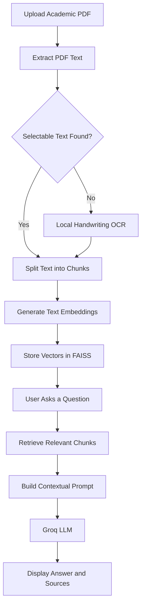

# StudyMate AI 📚

### AI-Powered Academic Document Assistant Using NLP

StudyMate AI is an intelligent academic document assistant that helps students understand lecture notes, textbooks, reports, and other study materials using Natural Language Processing (NLP), Retrieval-Augmented Generation (RAG), and Large Language Models (LLMs).

Upload a PDF, generate a structured summary, ask questions about its content, and explore relevant source passages through a simple Streamlit interface. For scanned handwritten documents, the application includes a local handwriting OCR fallback.

The goal is to make studying more efficient by turning static academic documents into interactive learning resources.

---

## ✨ Features

- **📄 PDF Upload and Processing**  
  Upload academic PDFs and extract their text for further processing.

- **📝 AI-Powered Summarization**  
  Generate structured summaries of important concepts and information from your study material.

- **💬 Document-Based Question Answering**  
  Ask natural-language questions and receive answers grounded in retrieved document content.

- **🔎 Semantic Search**  
  Retrieve relevant passages using text embeddings and FAISS vector similarity search.

- **📚 Source Passages**  
  Inspect the document context used to generate answers, helping you verify information against your notes.

- **🧠 Conversational Follow-Ups**  
  Continue asking questions about the uploaded document within the same study session.

- **✍️ Handwriting OCR Fallback**  
  Use a locally executed TrOCR handwriting recognition model when the PDF does not yield selectable text.

- **⚡ GPU-Accelerated OCR**  
  Use CUDA-compatible PyTorch for local OCR inference when a supported NVIDIA GPU and compatible environment are available.

- **🎨 Streamlit Interface**  
  A browser-based study workspace with document upload, summaries, chat, and source inspection.

---

## 🛠️ Technology Stack

| Technology | Purpose |
|---|---|
| Python | Core application logic |
| Streamlit | Interactive user interface |
| LangChain | LLM integration and document-processing workflow |
| Groq API | Language-model inference |
| ChatGroq | Connects LangChain to Groq models |
| Hugging Face | Embedding and OCR model ecosystem |
| Sentence Transformers | Text embeddings for semantic retrieval |
| FAISS | Vector storage and similarity search |
| PyMuPDF | PDF page rendering and document processing |
| OpenCV | Image processing for handwriting OCR |
| PyTorch | Local handwriting recognition inference |
| TrOCR | Handwritten text recognition |
| Git and GitHub | Version control and source-code hosting |

---

## 🏗️ How It Works

StudyMate AI uses a Retrieval-Augmented Generation (RAG) workflow to answer questions about uploaded documents.



### Processing pipeline

1. **Document ingestion:** The application receives the uploaded PDF and attempts to extract its selectable text.
2. **OCR fallback:** When no selectable text is extracted, the local handwriting OCR pipeline attempts to recognize text from rendered PDF pages.
3. **Text chunking:** Extracted text is split into smaller chunks to support retrieval.
4. **Embedding generation:** Text chunks are converted into vector representations.
5. **Vector indexing:** FAISS stores the vectors for similarity-based retrieval.
6. **Question processing:** The user's question is used to retrieve relevant document chunks.
7. **Answer generation:** Retrieved context is passed to the configured Groq language model.
8. **Response display:** The application displays the generated answer and relevant source passages.

**Important:** The current OCR fallback is triggered when no selectable text is extracted from the PDF. A mixed PDF containing both selectable text and scanned pages may require additional page-level OCR handling.

---

## 📁 Project Structure

The main application and supporting modules are organized as follows. Your repository may contain additional configuration and dependency files.

```text
StudyMate-AI/
│
├── src/
│   ├── app.py                 # Streamlit application
│   ├── ingest.py              # PDF ingestion and chunking
│   ├── retriever.py           # FAISS retrieval workflow
│   └── handwriting_ocr.py     # Local handwriting OCR
│
├── .streamlit/
│   └── secrets.toml           # Local secrets; do not commit
│
├── requirements.txt            # Python dependencies
├── .gitignore                  # Files excluded from Git
└── README.md                   # Project documentation
```

---

## ⚙️ Installation and Setup

### Prerequisites

Make sure you have:

- Python 3.10 or another Python version supported by your installed dependencies.
- Git.
- A Groq API key.
- Internet access for API calls and initial model downloads.
- Sufficient RAM and disk space for the embedding and OCR models.

An NVIDIA GPU is optional. CPU inference may be possible, but local OCR can be slower.

### 1. Clone the repository

```bash
git clone https://github.com/anuragkrgupta/StudyMate-AI.git
cd StudyMate-AI
```

### 2. Create a virtual environment

On Windows PowerShell:

```powershell
py -3.10 -m venv .venv
.\.venv\Scripts\Activate.ps1
```

If PowerShell blocks activation, you can use Command Prompt instead:

```cmd
.venv\Scripts\activate.bat
```

### 3. Install dependencies

If the repository contains `requirements.txt`, run:

```bash
python -m pip install --upgrade pip
pip install -r requirements.txt
```

If the dependency file is missing, create one containing the packages required by the project's imports and configured model versions before running the application.

**Compatibility note:** PyTorch, CUDA, NumPy, Transformers, and the LangChain packages can have version-specific compatibility requirements. Use compatible versions rather than upgrading all packages indiscriminately.

### 4. Configure the Groq API key

Create the file:

```text
.streamlit/secrets.toml
```

Add your credentials and model configuration:

```toml
GROQ_API_KEY = "your_groq_api_key"
GROQ_MODEL = "openai/gpt-oss-120b"
```

Replace the example API key with your own key.

You can obtain a Groq API key from the [Groq Console](https://console.groq.com/).

The configured model must be available to your Groq account. If you use a different model, update `GROQ_MODEL` accordingly.

**Security:** Never commit your actual API key, `.streamlit/secrets.toml`, or `.env` files to GitHub.

### 5. Run the application

From the project root:

```bash
streamlit run src/app.py
```

Streamlit will display a local URL in your terminal, typically:

```text
http://localhost:8501
```

Open that address in your browser.

---

## 🚀 How to Use StudyMate AI

1. Launch the application.
2. Upload a PDF containing lecture notes, textbook chapters, reports, or other academic material.
3. Wait for document processing and vector indexing to complete.
4. Select **Generate summary** to create a structured overview of the material.
5. Enter a question in the document chat.
6. Review the answer and inspect the retrieved source passages.
7. Ask follow-up questions to explore specific topics in greater detail.

### Example questions

You can ask questions such as:

- "Summarize the important concepts in this chapter."
- "Explain the difference between supervised and unsupervised learning."
- "What are the advantages and disadvantages of this technique?"
- "Give me five exam-oriented questions based on this document."
- "Explain this concept with a simple example."
- "Which passage in my notes explains this topic?"

The quality of answers depends on the extracted text, retrieval results, document content, and language-model output.

---

## ✍️ Handwriting OCR

StudyMate AI includes a local OCR module designed to recognize handwritten text from scanned PDF pages.

The OCR pipeline uses:

- **PyMuPDF** to render PDF pages into images.
- **OpenCV** to preprocess images and detect text-line regions.
- **TrOCR** to recognize handwritten text.
- **PyTorch** to execute model inference.

The handwriting model is downloaded from Hugging Face when needed and may require an initial internet connection.

### Limitations

- Handwriting recognition depends on image quality, writing style, and line segmentation.
- Mathematical equations, diagrams, tables, and unusual symbols may not be recognized accurately.
- Local OCR can consume substantial RAM and GPU memory.
- A compatible CUDA-enabled PyTorch installation is required for NVIDIA GPU acceleration.
- Mixed PDFs with selectable text and scanned pages may need page-by-page OCR to ensure complete extraction.

Always verify OCR output before relying on it for important academic work.

---

## 🔐 Security and Privacy

- Keep API keys in Streamlit secrets or environment variables.
- Exclude secrets and private documents from version control.
- Avoid uploading confidential academic or personal documents to public repositories.
- The application sends retrieved document context to the configured language-model API when generating responses.
- Local OCR inference does not itself require sending page images to Groq, although the surrounding application may send extracted text as LLM context.
- Model downloads and API requests require network access.

Review the configured services and their privacy policies before processing sensitive documents.

---

## ⚠️ Known Limitations

- PDF extraction quality depends on the document's structure and formatting.
- OCR may struggle with low-resolution scans, complex handwriting, equations, and multi-column layouts.
- Semantic retrieval may miss relevant passages when chunking or embeddings are unsuitable.
- Answers can be incomplete or incorrect, even when document context is provided.
- Source passages should be checked against the original document. A displayed chunk is not necessarily a verified page citation.
- Large PDFs may increase processing time and memory usage.
- GPU acceleration depends on the installed PyTorch build, compatible drivers, and available VRAM.
- Groq API availability, model access, rate limits, and usage restrictions may affect responses.

---

## 🧪 Troubleshooting

### Streamlit command not found

Activate your virtual environment and use:

```bash
python -m streamlit run src/app.py
```

### Missing Groq API key

Check that `.streamlit/secrets.toml` exists and contains a valid `GROQ_API_KEY`. Restart Streamlit after changing secrets.

### Module not found

Install the project's dependencies in the same Python environment used to run Streamlit:

```bash
python -m pip install -r requirements.txt
```

### CUDA is unavailable

Check your PyTorch installation:

```bash
python -c "import torch; print(torch.__version__); print(torch.cuda.is_available())"
```

A result of `False` means PyTorch is not currently able to use CUDA. Check the installed PyTorch build, driver compatibility, and GPU setup.

### PDF produces no useful text

Check whether the PDF contains selectable text or scanned images. For scanned documents, verify that the OCR dependencies and model can load successfully.

### Answers are irrelevant

Try a more specific question and confirm that the PDF was processed successfully. Retrieval quality depends on the extracted text, chunking, embeddings, and search results.

---

## 🔮 Future Improvements

Potential improvements include:

- Page-level OCR for mixed scanned and selectable-text PDFs.
- More accurate page-number citations for retrieved passages.
- Improved extraction of tables, mathematical equations, and complex layouts.
- Configurable chunk sizes and retrieval parameters.
- Downloadable summaries and exam-oriented question sets.
- Support for multiple documents in one study session.
- Automated tests for ingestion, retrieval, and response quality.
- More robust error handling and processing-status feedback.

These are possible future enhancements and should not be considered implemented unless present in the current codebase.

---

## 🎓 Academic Use

StudyMate AI is intended to support learning, revision, and exploration of academic material. It should complement, rather than replace, reading and understanding the original sources.

Always verify important information against your course material and instructor guidance.

---

## 👨‍💻 Author

**Anurag Kumar**

MCA Student | AI/ML and NLP Enthusiast

GitHub: [@anuragkrgupta](https://github.com/anuragkrgupta)

Project repository: [StudyMate-AI](https://github.com/anuragkrgupta/StudyMate-AI)

---

## 📄 License

No license has been specified here. Add a `LICENSE` file and update this section if you decide to distribute the project under an open-source license.
